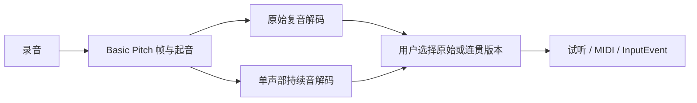
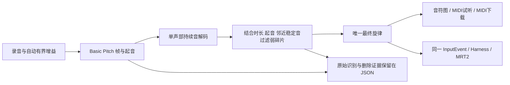

# 哼唱碎音清理与单一输出（2026-11-16）

本次修改只涉及优化版哼唱入口；保留三个独立输入页面，不改变 Harness 的策略或长期状态。

## 为什么 Basic Pitch 后面还需要整理

Basic Pitch 自带起音、帧激活、最短音长等音符解码条件，并不是完全不处理短片段。但人声从 do 滑向 mi 时经过的音高是真实声音，模型不能可靠判断用户是否想把它写成独立音符。单纯增大最短音长，也会删掉有意唱出的快音。

本项目原有单声部解码已经使用音高持续时间和迟滞来抑制过渡碎片。这次增加基于上下文的保守过滤，并修正分数计算。它是感知层的启发式整理，不是模型重训练，也不推断 BUILD / PRESERVE 等策略。

## 前后流程

## 实现

- 删除“原始识别 / 连贯哼唱”切换；取消增益、裁剪参数控件。内部默认有界增益，首尾不裁剪；保留试听音色和生成后端选择。
- 音符同时满足以下条件才过滤：持续时间 ≤220 ms、模型平均激活 <0.32、起音激活 <0.65，并且激活低于紧邻稳定音的 65%。邻近稳定音需 ≥280 ms、激活 ≥0.24、间隔 ≤120 ms；不使用远处较响的乐句作为参照。
- 不因时长短、音量小或跳音幅度大单独删除；缺少证据时保留；不延长邻居去填删除后的空隙，不强制拍点或音阶。
- 音符平均激活改为只统计最终分段内的帧，按时长加权，避免下一音的确认帧污染前一音分数。
- 起音证据取音符起点前后一帧的最大值，并同步用于换音确认，避免音高与起音峰值错开一帧时误删快音。相同音高的声学再起音逻辑保持原样。
- JSON 保留 `results.raw`、`results.cleaned.removedNotes`、删除原因及阈值版本。公开 InputEvent 仍是 1.2.0，`confidence=null`，未改变下游契约。

## 用户样例

提供的 InputEvent 与详细 JSON 中的 MelodyDocument 完全相同；并非一个 MRT2 输出、一个 MIDI 文件。

| 原音符 | 起点 | 时长 | 处理 |
|---|---:|---:|---|
| h14 / MIDI 43 | 6.610 s | 128 ms | 疑似弱碎音，过滤 |
| h18 / MIDI 54 | 8.179 s | 197 ms | 疑似弱碎音，过滤 |
| h20 / MIDI 50 | 9.014 s | 151 ms | 疑似弱碎音，过滤 |

已有单声部记录 24 → 21 音，原始 73 音保留。h4、h6、h7 等有更充分证据的短音保留。重处理文件在 `tmp/humming-cleanup/`，包含修改前/后 MIDI、最终 JSON、InputEvent 和报告。

**证据边界：**原录音与帧数组未提供，以上只是对旧版记录的再处理，不能重新计算已修正的帧分数，也不是人工标注的准确率。稳定且清晰的过渡音、刻意滑音与快速连奏仍可能混淆；不能承诺完全理解用户想保留的音。原录音音频未做降噪或改写。

## 验收

1. 刷新 `http://127.0.0.1:4197/optimized/dist/`，确认没有识别版本或清理参数选项。
2. 各录一段：稳定长音、明显分开的快速 do–re–mi、连续滑过的 do→mi、轻声乐句。回听原音与 MIDI，检查是否多出碎音、是否删掉有意短音、停顿是否改变。
3. 同时下载 MIDI、InputEvent 和 JSON；音符数量、音高、起止应一致（MIDI 允许一个 tick 的舍入误差），删除原因可在 JSON 查到。
4. 用原始问题录音重新导入，才能评估新分段分数与过滤的联合效果；仅重放旧 JSON 无法替代这一步。

## 验证记录

- `node --test web/optimized/tests/*.test.mjs`：31 项通过，包括真实记录回归、快音保护、弱声乐句、未知证据、音符时序、滑音中间片段、起音错位和 MIDI/InputEvent 一致性。
- 三组 Python 契约与输入链路测试：78 项通过。
- 重处理后的 InputEvent 通过团队 Python 契约验证。
- 最终前端构建通过；浏览器真实 Basic Pitch 合成示例输出 5 个音符；界面没有版本选择；MIDI 试听进入播放状态。
- 最终构建的合成示例经真实 MRT2 返回 generated preview，浏览器音频时长 9.6 秒且播放至末尾；页面明确显示音乐状态未提交。没有浏览器 error 日志。此项不是用户原录音的 MRT2 听感对比。
- 浏览器实际下载的 MelodyDocument 为 appVersion 1.2.0，音高 `[60,64,67,64,62]`，零删除；用同一事件构造器生成的事件通过 Python 契约校验。浏览器工具的多文件下载捕获超时，未取得本轮所有下载件做逐字节比较；该一致性由真实导出函数的单元测试覆盖。
- 独立代码审查发现的起音错位误删问题已修复，复审无阻塞项。

这些结果不等于真人麦克风准确率或主观听感验收。

## 后续真人录音复验：v1.3.0

用户补充了 9.36 秒原录音 `jammate-1edc0d7d-original.webm`，要求通用处理，不按歌曲或指定旋律修答案。对应旧版 v1.1.0 事件有 28 音。用 v1.2.0 从原声重新推理得到 29 音、弱碎音过滤零删除：旧分数筛选不足，不能把问题归咎于页面未刷新。

原声连续音高分析显示两类可定位的误切：相邻片段实际中心仅差约 0.3–0.4 半音，却触发相邻 MIDI 音；以及短暂下探/上冲没有足够稳定音高支撑。现增加 `pitch-track.js`：

- 在 Basic Pitch 候选附近估计连续基频和周期性；不依据歌曲、音阶、固定目标音符数、录音 ID 或时间点。
- 使用 35 ms 或至少三个基频周期的分析窗，取较长者。固定 70 ms 窗曾把真实短音抹平，该问题由真实波形组合测试发现并修正。
- 连续相邻片段的音高中心跨度 ≤0.55 半音、没有声学再起音或停顿，才允许合并；限制整组中心跨度，防止链式合并吞掉整个音阶。
- 短暂偏离需同时满足：周期性覆盖足够、稳定核心既短于 90 ms 又不足音长的 70%、位于有支撑的相邻音之外、偏离有限、没有声学再起音。回到同一音的偏离吸收进持续音；其他偏离保留时间空隙。稳定的短音不会仅因短而删除。
- 证据不足时保留原解释；原始识别、连续音高摘要和每次处理原因保留在 JSON。合并音的模型分数设为 null，避免把不同音高的分数伪装成一个精确分数。
- 页面仍只输出一版。页脚显示“哼唱识别 v1.3.0”，构建后的脚本 URL 带内容哈希，重新加载时避免复用旧脚本；已经打开的页面仍需刷新。

最终对同一原录音：v1.2 重跑 29 → v1.3 **23 音**，网页实际导入原 WebM 也得到 **23 音、5 处整理**。主要位置约为 2.08 s、2.99 s 的边界误切，4.38 s 的短暂往返，以及 6.39 s、7.95 s 的不稳定偏离。启发式判定不等于人工真值，剩余音符或被吸收的装饰音仍需主观验收。

最终验证：

- 全部 41 项 JS 单元/组合测试通过，包含实际 PCM → 分段 → 连续音高 → 整理 → MIDI/InputEvent 的检查。
- `node web/optimized/tests/audio-regression.mjs`：7/7 真实 Basic Pitch 合成音频回归通过（长音、重复音、音阶、停顿、短音、轻声、加噪）；音高序列全部匹配，边界最大误差约 65.7 ms。这是合成样例，不代表所有真人准确率。
- 独立复审补充 640 组纯音/谐波短音检查：MIDI 37–83、上下半音、70–116 ms、两种帧率与初相位，全部保留三音序列。
- 最终网页已导入用户原录音，显示 v1.3.0 与 23 音，MIDI 试听进入播放状态，无浏览器 error 日志。两次浏览器识别分别约 29.2 秒、17.6 秒；离线新整理步骤约 0.11 秒，整段推理仍由 Basic Pitch 主导。
- 最终事件通过团队 Python 契约校验；MIDI 和 InputEvent 使用同一音符列表。

可复听文件在 `tmp/humming-real/`：`before-midi-audition.wav` 来自用户旧版 28 音，`after-midi-audition.wav` 来自最终 23 音，使用相同合成音色与力度；`improved.mid`、`improved.input-event.json`、`improved.json` 是最终离线复验产物。`verified-v1.3.jpg` 是同原录音的网页验收截图。没有重训练 Basic Pitch，没有改写原录音，也没有新增用户调参选项。
