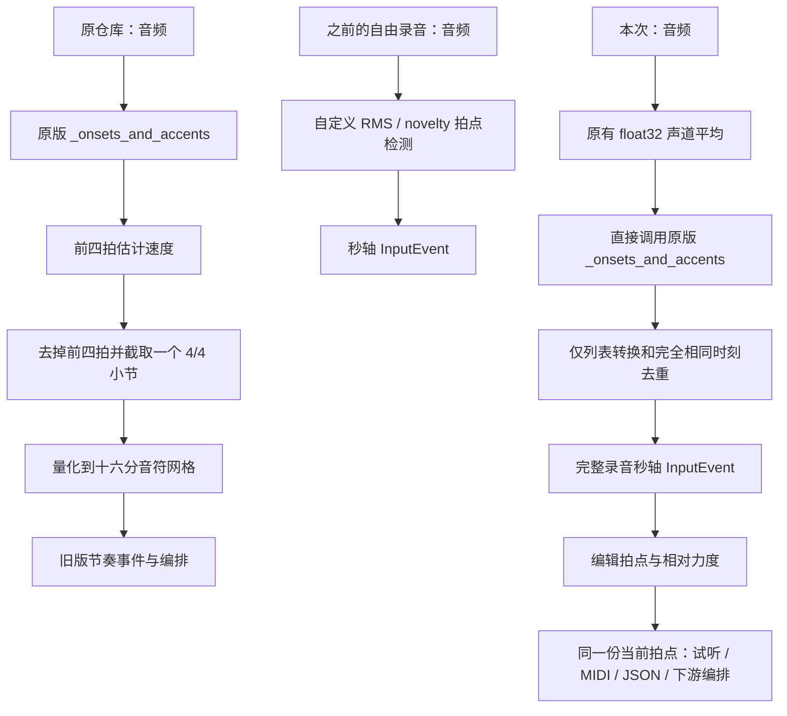

# 恢复原版 librosa 识别 · 2026-11-17

本次以用户最后确认的“原样复用整段识别函数，只移除定速、截小节和量化包装”为准。自由录音直接进入队友已有的识别函数；本次不调检测参数，不增加去噪或近邻拍点合并规则。早先试做的自定义检测方案未部署，相关结果只保存在本地历史记录中。

## 三条流程的区别

四拍定速、截小节和量化是原项目在 librosa 检测之外的应用包装。旧接口保留兼容；当前自由录音入口绕过它们。已有网页、0.5–30 秒输入限制、编辑器和下游接口保留。

## 原样保留的识别逻辑

基准为本仓库已有的队友提交 `a63a0f5f579cbc36ed0dfa31874c8888e4873cbd`。`src/jammate/analysis/rhythm.py` 和 `tempo.py` 不修改；自由录音只通过 `free_rhythm.py` 调用前者的 `_onsets_and_accents`。

- float32 音频；多声道按原有方式取平均。
- 整段峰值小于 `0.01` 时返回空；两端各补 `100 ms` 静音。
- 原调用 `librosa.onset.onset_detect(..., hop_length=256, units="time", backtrack=True)`，其他参数继续使用原库默认值。
- 回溯起音，扣除补零时长，按原逻辑处理录音边界。
- 用起音后 `60 ms` 的峰值作为力度，保留至少达到 `max(0.01, 整段峰值 × 0.12)` 的候选，再按保留峰值归一化。

原版回溯可能产生完全相同的时间戳，而现有 InputEvent 要求时间唯一。因此适配层对**完全相等**的时间戳只留一项、取最大力度，再转为普通列表。没有时间容差；不同时间的拍点绝不因距离近而合并。

这也保留了原版的局限：全局力度阈值可能漏掉强拍后的弱拍；快速相邻拍可能被原库回溯合到同一时刻；有些噪声仍可能成为候选。此次验收确认“忠实复用原版并贯通自由时间线”，不声称解决了全部噪声或漏拍。

## 数据如何保持一致

`InputEvent 1.3.0` 的 `payload.rhythm` 是当前拍点，`payload.raw_rhythm` 保存首次识别快照。用户修改起音或力度后，试听、MIDI、下载 JSON 和下游请求共同使用当前拍点；原始快照保留。没有从这段录音推断 BPM 或拍号，未经校准的 confidence 为 `null`。

纯 MIDI 把秒数编码为高精度 tick，使用鼓通道、音符 36，力度 `max(1, round(accent × 127))`。120 BPM 只是时间编码参考，最细 tick 为约 `20.83 μs`。文件保留完整录音时长与首尾空白。服务器返回的 MIDI 拍点也供页面试听使用。

“用当前节奏生成音乐”的跟随编排沿用现有下游：保留输入锚点，但按编排器自己的规则映射鼓种和力度。MRT2 是另一个模型生成环节；本次检测器修改不需要重新推理 MRT2，也不能用模型生成声音证明原拍点的准确率。

## 最终验证

最终适配层 SHA256 为 `beab040b6e31dbb4cb8201bd0f4f264bd35a58d96555400b3569365b45c00a8e`。原 `rhythm.py`、`tempo.py` 相对 `a63a0f5` 的 diff 为空。

- 完整 Python 套件 **498 项通过**；其中自由节奏、旧识别和 MIDI 链路专项 **78 项通过**。原有 JS 编辑、录音与交接测试 **11 项通过**，本轮未修改这些 JS 文件。
- Windows 与 WSL 各做 **40 项逐项一致性核对**，覆盖 28 段单声道输入和 12 种双声道变体；全部与原函数一致。28 段输入的拍点和力度在两个环境中也完全相同。
- Windows 使用 librosa `1.0.0`，运行服务的 WSL 使用 `1.0.1`；本次没有升级依赖。上述跨环境相等只适用于本轮测试材料，不承诺所有未来版本一致。
- 真人 7.14 秒录音：旧 RMS 检测器 **105 个**，恢复原函数后 **10 个**，其时间与力度均等于原函数。真人录音没有人工标注，不据此声称准确率。
- 内置 7.15 秒示例含 10 个标注拍击，原函数检测 **8 个**，漏掉约 `0.840`、`4.570` 秒的两个弱拍。原音频保留，没有为掩盖漏拍而换示例。

固定合成测试采用 **30 ms 内一对一匹配**；超出容差会同时记一次漏检和误检，因此“额外拍点”不一定全是噪声：

| 测试组 | 标注拍点 | 匹配 | 漏检 | 额外拍点 |
|---|---:|---:|---:|---:|
| 核心用例 | 41 | 36 | 5 | 9 |
| 额外评估用例 | 17 | 16 | 1 | 5 |
| 已有示例 | 19 | 14 | 5 | 2 |
| 合计 | 77 | 66 | 11 | 16 |

48 对符合条件且被匹配的同音色强弱拍顺序正确；漏掉的拍击不计入该分母。这不是 100% 力度准确率。测试明确保留了弱拍、快双击、背景声音起止的原版局限，也不是现实麦克风准确率评估。

旧自定义检测器的 11 项准确率断言在恢复原版后失败，失败记录保留。测试随后按用户选择改为“原版行为一致与数据贯通”，没有使用跳过或 xfail 掩盖，也没有把测试全绿解释为声学效果全对。最终依据是 `tmp/librosa-recovery/upstream-core-report.md`、`evaluation/final-upstream-report.md` 和各自 JSON / 日志；早期自定义方案的 77/77 结果不属于此版本。

另一位 GPT-6 Astra 完成只读审查，没有发现阻碍交付的问题。审查后重新确认端口、进程命令和工作目录，只重启本工作区的 4197 服务及其两个后端工作进程；`/api/ready` 返回本工作区根目录与 `implementation: workspace`。没有刷新、关闭或操作用户页面。

实际 HTTP 联调已通过，证据在 `tmp/librosa-recovery/evaluation/integration-results.json` 与 `service-current.json`：

保存的两份 HTTP 原始事件还与相同音频的本地适配层逐项比较，时间和力度的最大差均为 **0**，见 `http-exact-local-comparison.json`。

| 实际输入 | 识别拍点 | 原始纯 MIDI 音符 | 编辑后纯 MIDI 音符 | 跟随编排锚点 |
|---|---:|---:|---:|---:|
| 真人 7.14 秒录音 | 10 | 10 | 10 | 10 |
| 内置 7.15 秒示例 | 8 | 8 | 8 | 8 |

两份输入均实际移动首拍，并将前两拍力度改成 `0.18`、`0.92`：读取返回 MIDI 字节，核对起音、力度、完整录音时长及页面试听所用的 `hits`；核对已编辑 JSON、保留的原始快照、下游请求、状态和跟随编排 MIDI。纯 MIDI 仍为 7.14 / 7.15 秒；当前 120 BPM 编排补足到 8 秒，合成 WAV 包含尾音为 9.5 秒。这是原有编排及本地合成结果，本轮未调用 MRT2 推理，不将该 WAV 标记成 MRT2 生成。

## 自己验收

1. 打开 [自由节奏页](http://127.0.0.1:4197/rhythm.html)。已有录音仍在页面时可直接重新点“识别节奏”，无需先刷新。新录音直接拍一段再停止，不需要前四拍校速或凑满一小节。
   内置示例当前应得到 8 个拍点；两个弱拍漏检是原版行为，用来观察局限，不作为“已全部识别”的样例。
2. 核对时间线是否覆盖整段录音，拍点是否出现在实际击打附近。先听原音，再点“听 MIDI”对照。漏拍或误拍需要如实记录；恢复原版不等于人工意图标注。
3. 把第一拍向后移动约 `0.04 秒`（不越过下一拍），把力度改为 `48`。保存、试听，下载 MIDI 和 InputEvent JSON。当前 `rhythm` 应变化，`raw_rhythm` 应保留原始值；力度应按 `48/127` 表示。
4. 添加、删除一拍并撤销，确认列表与试听同步。生成一次“跟随拍点”伴奏，之后再编辑节奏，旧生成结果应清除，重新生成应使用新事件。
5. 强弱验收用相同敲击方式、相近距离拍几次明显强弱变化。柱高只表示本录音内相对峰值，不能跨设备比较，也不保证不同音色的主观响度可直接比较。

本轮未操作用户浏览器，未提交或推送代码，未清理或迁移磁盘。所有本轮实现与独立核查均由 GPT-6 Astra 执行。
