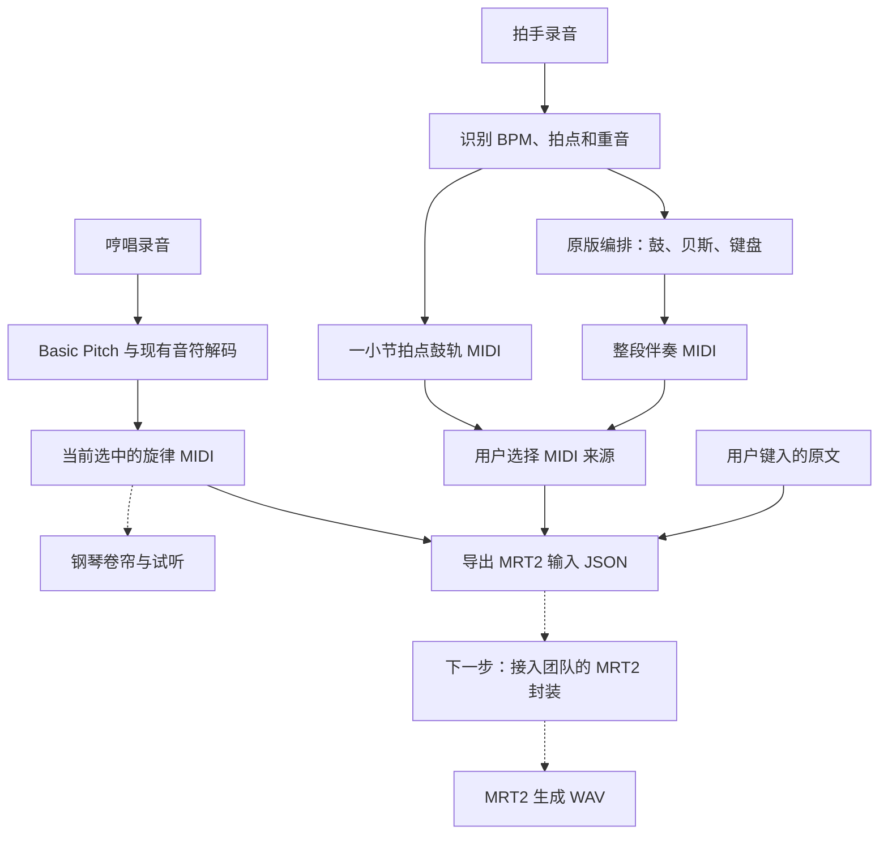

# JamMate 的 MRT2 输入交接

在 [JamMate 工作台](http://127.0.0.1:4188/) 导出输入包，可以把这次的旋律、节奏或文字交给接入 MRT2 的同学。启动步骤见 [运行说明](RUN.md)。执行需求见 [执行 prompt](MRT2_INPUT_EXECUTION_PROMPT.md)。

| 页面 | 操作与交付 |
| --- | --- |
| 从旋律出发 | 录音、导入或载入示例后点「转成 MIDI」。在优化版页面选「原始识别」或「连贯哼唱」，再点「导出 MRT2 输入」。输入包里的旋律 MIDI 与当前「下载 MIDI」完全相同。 |
| 从律动出发 | 点「识别节拍」后可直接选「只用识别到的拍点」。MIDI 只有一小节鼓轨，拍点从正式小节的第一拍算起，保留速度与相对重音。选「用已生成的鼓、贝斯、键盘伴奏」时，先点上方的「生成音乐」。可以下载所选 MIDI 或导出完整输入包。 |
| 从一句话出发 | 在文字框输入内容后点「导出原文给 MRT2」。导出保留原样的空格、标点和换行。页面上的「生成第一段」继续使用原版 Agent。 |

拍手页在重新识别、换录音或更改编排模式、力度、小节数后，需要重新生成伴奏才能导出对应的伴奏 MIDI。纯拍点始终来自当前识别结果，和编排设置无关。



## 导出的 JSON

| 字段 | 含义 |
| --- | --- |
| `schema_version` | 数字 `1`。 |
| `source` | `humming`、`rhythm_hits`、`rhythm_arrangement` 或 `text`。 |
| `prompt` | 文字页原文。MIDI 路径为 `null`，接入端可用默认风格或让用户选择。 |
| `midi_base64` | 标准 MIDI 文件的 Base64 字符串。文字路径为 `null`。 |
| `duration_s` | MIDI 的片段时长，单位为秒，包含片段末尾的休止。文字路径为 `null`，由接入端选择生成时长。 |

前端构建输入包的函数是 [`prepareMrt2Input()`](../../web/mrt2-input.js)。接入 API 时可以复用它的返回值作为请求体。

## 接 MRT2

团队在 `3123738092/aiaa3800_jammate` 的 `codex/jammate-workbench` 分支上已有 [MRT2 封装](https://github.com/3123738092/aiaa3800_jammate/blob/5dc9fb8e57f91a6bc212d313c944b07e42e0c4d6/src/jammate/render/mrt2.py) 和 [安装与运行说明](https://github.com/3123738092/aiaa3800_jammate/blob/5dc9fb8e57f91a6bc212d313c944b07e42e0c4d6/docs/MRT2_BACKEND.md)。在包含该封装、依赖和模型权重的环境中使用下面的示例。

- **文字**直接传给 `generate(prompt, ...)`。封装会调用 MRT2 库的 `embed_style()` 和 `tokenize_style()` 来获得风格条件。
- **MIDI**先从 Base64 解码成标准文件，再传文件路径给同一个 `generate()`。团队的 `midi_conditioning()` 会把它转换为每秒 25 帧的音符和鼓条件。当前转换保留音高、时序及鼓是否激活，力度、具体鼓件和分轨乐器属于 MIDI 原件中的信息。
- **输出**是 WAV。可以把原输入包和 MIDI 随 WAV 一起保存，便于对照生成条件。

将下列示例保存成 `render_handoff.py`。它同时支持文字包和 MIDI 包。

```python
import base64
import json
import sys
from pathlib import Path
from tempfile import TemporaryDirectory

import pretty_midi

from jammate.render.mrt2 import generate

source_path, output = map(Path, sys.argv[1:])
bundle = json.loads(source_path.read_text(encoding="utf-8"))
if bundle["schema_version"] != 1:
    raise ValueError("Unsupported MRT2 input version")

output.parent.mkdir(parents=True, exist_ok=True)
with TemporaryDirectory(dir=output.parent) as folder:
    midi = None
    duration = bundle["duration_s"] or 4.0
    if bundle["midi_base64"] is not None:
        midi = Path(folder) / "input.mid"
        midi.write_bytes(base64.b64decode(bundle["midi_base64"], validate=True))
        duration = max(duration, pretty_midi.PrettyMIDI(str(midi)).get_end_time())
    generate(bundle["prompt"] or "a warm instrumental band",
             midi=midi, duration=duration, output=output)
```

```sh
python render_handoff.py mrt2-text.json text.wav
python render_handoff.py mrt2-rhythm_hits.json rhythm.wav
```

## 验收

按 [运行说明](RUN.md) 安装、构建并启动工作台。在仓库根目录运行以下命令。浏览器测试需要 Edge 和 Playwright，也接受 `PLAYWRIGHT_MODULE_PATH` 指向安装好的 Playwright Core。

```powershell
New-Item -ItemType Directory -Path tmp -Force | Out-Null
python -m pytest tests/test_rhythm_midi_handoff.py --basetemp tmp/pytest-handoff
node --test tests/mrt2-input.test.mjs
node tests/mrt2-input-browser.mjs
```

浏览器测试覆盖纯拍点与整段伴奏的切换、旧伴奏失效、哼唱 MIDI 字节一致、文字原样导出以及原版伴奏和文字生成。使用合成示例，测试范围截至输入导出和原版生成。

2026-11-13 在 Windows 上通过 439 项 Python 测试、32 项 JavaScript 测试、两套前端构建和 6 组 Edge 浏览器脚本。使用团队适配器单独读取节拍示例的一小节纯拍点 MIDI 和一小节整段伴奏 MIDI，两份都生成了包含 4 个鼓起音的条件。纯拍点的音高条件为空，整段伴奏保留贝斯与键盘音高。本次验证截至条件转换。
